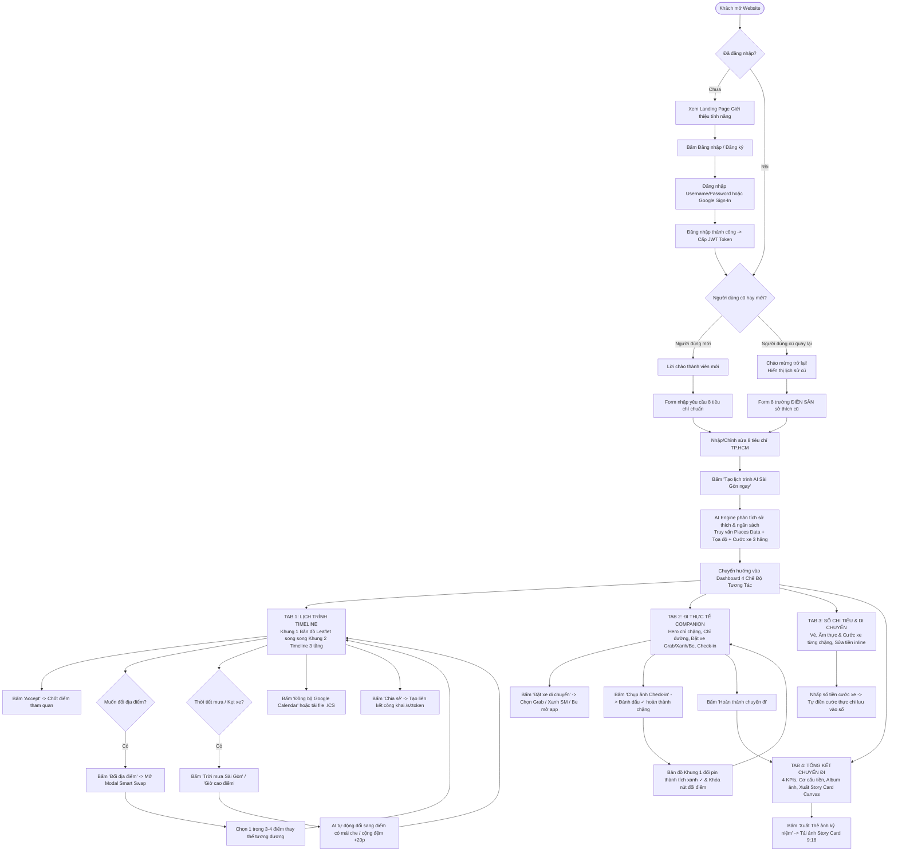

# 📋 01. Đặc Tả Dự Án, Phạm Vi, Luồng Người Dùng & Lộ Trình (Project Specification)

> **Tài liệu hợp nhất:** Gộp từ `01-tong-quan.md`, `02-scope.md`, `yeu-cau-moi.md`, `user-flow.md`, `thay-doi-so-voi-ke-hoach-cu.md` và `15-roadmap.md`.
> *(Lưu ý: Bảng phân công nhiệm vụ 7 thành viên được quản lý tập trung duy nhất tại [`README.md`](../README.md)).*

## Mục lục
- 1. Tổng quan Dự án
- 2. Phạm vi Tính năng (Scope)
- 3. Đặc tả chi tiết 7 Yêu cầu mới
- 4. Luồng Trải nghiệm Người dùng (User Flow)
- 5. Nhật ký thay đổi (Changelog)
- 6. Lộ trình phát triển (Roadmap)

---

## 📌 1. Tổng quan Dự án (Cập nhật v3 theo 7 Yêu cầu mới của Giảng viên)

- **Tên project**: Website AI Lên Lịch Trình Du Lịch TP.HCM (HCMC AI Travel Planner)
- **Loại hình**: Đồ án tốt nghiệp / Đồ án môn học, thuyết trình và bảo vệ demo bằng tiếng Anh hoặc tiếng Việt
- **Mô tả cốt lõi**: Ứng dụng web thông minh hỗ trợ lập kế hoạch và đồng hành du lịch tại TP. Hồ Chí Minh. Người dùng bắt buộc đăng nhập để hệ thống nhận diện danh tính. Người dùng nhập thông tin qua bảng yêu cầu 8 tiêu chí chuyên sâu cho TP.HCM (số ngày, quận huyện, ngân sách, sở thích, số người, phương tiện, nhịp độ, ghi chú). AI vận hành tối ưu hóa lịch trình chi tiết, hiển thị trực quan qua bố cục 2 khung hình song song (Bản đồ Leaflet Khung 1 và Lịch trình Timeline Khung 2), 4 chế độ trải nghiệm (Timeline, Đi thực tế Companion, Sổ chi tiêu di chuyển, Tổng kết chuyến đi), kết hợp Google Places API lấy dữ liệu địa điểm thật, kịch bản dự phòng khi trời mưa/kẹt xe, gọi xe 3 hãng (Grab, Xanh SM, Be) và tính năng đột phá **Đồng bộ tự động lên Google Calendar / xuất .ICS**.
- **Đối tượng người dùng**: Du khách trong và ngoài nước đến TP.HCM cần lịch trình tối ưu, tránh kẹt xe, tránh mưa ngập và muốn quản lý lịch trình chuyên nghiệp trên điện thoại.
- **Phạm vi địa lý**: Tập trung 100% vào TP. Hồ Chí Minh (các quận nội thành và khu vực phát triển: Q1, Q3, Q5, Q7, TP. Thủ Đức...).
- **Ngôn ngữ giao diện**: Tiếng Anh (hỗ trợ thuyết trình chuẩn quốc tế) và Tiếng Việt.

---

## 1.1. Sáu Nguyên tắc Sản phẩm Cốt lõi (Product Principles v3)

1. **Xác thực danh tính là nền tảng (Identity First):** Người dùng bắt buộc phải đăng nhập để sử dụng mọi tiện ích. Điều này giúp AI lưu giữ lịch trình, hiểu sâu sở thích và phục vụ cá nhân hóa chuẩn xác. Khách vãng lai chỉ xem Landing Page giới thiệu.
2. **Quy trình Lập kế hoạch Trực quan (Direct-Manipulation UI):** Form 8 tiêu chí chuyên sâu kết hợp AI Engine tối ưu hóa lộ trình, đưa thẳng vào Dashboard 4 Chế độ làm việc trực quan, loại bỏ việc phải đàm thoại chat thủ công.
3. **Dữ liệu thực tế chống ảo giác (Grounding 100%):** Mọi địa điểm đều phải có thật qua Google Places API (New), có rating, giờ mở cửa và tọa độ định vị trên bản đồ.
4. **Luôn có phương án dự phòng (Contingency by Default):** Thiết kế riêng cho TP.HCM: sẵn sàng phương án đổi điểm trong nhà khi trời mưa, né cung đường kẹt xe giờ cao điểm, đổi địa điểm linh hoạt khi hết bàn.
5. **Tiện ích thực tế đến phút cuối (Google Calendar Integration):** Lịch trình không chỉ nằm trên web mà được đồng bộ vào Google Calendar của người dùng để nhắc nhở giờ giấc trên điện thoại.
6. **Tập trung vào tính chuyên nghiệp (No Persona Distraction):** Bỏ hoàn toàn phần chọn nhân vật/giọng điệu hoạt họa rườm rà. AI hoạt động như một Trợ lý Chuyên gia Du lịch Bản địa chuẩn mực.

---

## 🎯 2. Phạm vi Tính năng (Scope v3 - Phân loại theo 7 Yêu cầu mới)

| Mức độ ưu tiên | Tính năng (Feature) | Mô tả chi tiết & Tiêu chí nghiệm thu |
|---|---|---|
| **P0 (Bắt buộc)** | **Xác thực & Bảo vệ tiện ích (Auth Gate)** | Bắt buộc đăng nhập để dùng tiện ích. Khách chỉ xem Landing Page giới thiệu. Hỗ trợ Username/Password và Google Sign-In. |
| **P0 (Bắt buộc)** | **Bảng nhập yêu cầu 8 tiêu chí TP.HCM** | Thu thập: Số ngày, Quận ở TP.HCM, Ngân sách, Sở thích, Số người, Phương tiện, Nhịp độ, Ghi chú đặc biệt. |
| **P0 (Bắt buộc)** | **AI Engine & Đổi địa điểm thông minh** | Form 8 tiêu chí -> AI sinh lịch trình tối ưu. Nút [Đổi địa điểm] đưa ra 2-3 lựa chọn thay thế qua Modal trực quan; khóa nút khi đã check-in. |
| **P0 (Bắt buộc)** | **Bố cục 2 khung hình & Bản đồ tương tác** | Khung 1 Bản đồ Leaflet song song Khung 2 Timeline 3 tầng chống đè chữ; đổi pin thành dấu tích xanh `✓` khi đã check-in; đồng bộ 2 chiều. |
| **P0 (Bắt buộc)** | **Chế độ Đi thực tế & Gọi xe 3 hãng** | Tab 2 Live Companion: Thẻ Hero chỉ đường, tích hợp đặt xe 3 app (Grab, Xanh SM, Be) với cước ước tính, check-in chụp ảnh thực tế. |
| **P0 (Bắt buộc)** | **Sổ chi tiêu có cước xe & Tổng kết chuyến đi** | Tab 3 Sổ chi tiêu cho phép sửa tiền xe inline; Tab 4 Tổng kết 4 KPI, cơ cấu 3 nhóm tiền, album ảnh và xuất Thẻ ảnh kỷ niệm Story Card (9:16). |
| **P0 (Bắt buộc)** | **Phương án dự phòng trời mưa & sự cố** | Nút bấm nhanh [Trời mưa], AI tự động hoán đổi điểm ngoài trời sang điểm trong nhà cùng quận; cảnh báo kẹt xe giờ cao điểm (17h-19h). |
| **P0 (Bắt buộc)** | **Lưu & Chia sẻ lịch trình chuyên nghiệp** | Lưu trữ trong My Trips; tạo link chia sẻ chỉ xem (/s/:token) thu hồi được; người nhận có nút [Sao chép vào tài khoản]. |
| **P0 (Bắt buộc)** | **Đột phá: Đồng bộ Google Calendar** | Khi người dùng đồng ý, tự động tạo các sự kiện trên Google Calendar đúng khung giờ, địa điểm và gửi thông báo nhắc trước 30 phút. |
| **P0 (Bắt buộc)** | **Chào mừng người dùng cũ & Form điền sẵn** | Nhận diện người dùng cũ, chào mừng nồng nhiệt và tự động điền sẵn (pre-filled) các sở thích, quận quen thuộc từ chuyến trước. |
| **ĐÃ BỎ HOÀN TOÀN**| **Chọn tính cách / Giọng điệu AI (Persona)** | Bỏ toàn bộ tính năng chọn nhân vật (Anh Hai, Chị Ba, Bạn Tư...) và giọng điệu. AI giữ duy nhất vai trò Trợ lý Chuyên gia Du lịch TP.HCM. |

---

## 📋 ĐẶC TẢ CHI TIẾT 7 YÊU CẦU MỚI (GIẢNG VIÊN HƯỚNG DẪN)
## Dự án: Website AI Lên Lịch Trình Du Lịch TP.HCM (HCMC AI Travel Planner)

---

## 1. YÊU CẦU 1: BẮT BUỘC ĐĂNG NHẬP ĐỂ SỬ DỤNG TIỆN ÍCH
### 1.1. Mục tiêu
Đảm bảo mọi tiện ích thông minh (Lập kế hoạch bằng AI, tương tác bản đồ, xem timeline chi tiết, chế độ đi thực tế Companion, quản lý sổ chi tiêu, chia sẻ lịch trình, đồng bộ Google Calendar) đều gắn liền với danh tính người dùng cụ thể. Khách vãng lai (Guest) chỉ xem trang giới thiệu (Landing Page) và phải đăng nhập/đăng ký để bắt đầu trải nghiệm. Mục đích cốt lõi: AI nhận diện người dùng, ghi nhớ sở thích, tích lũy lịch sử chuyến đi cũ để cá nhân hóa chuẩn xác.

### 1.2. Người dùng & Luồng thao tác
- **Khách (Guest):** Mở website chỉ thấy Landing Page giới thiệu tính năng, review mẫu và nút bấm kêu gọi hành động (CTA) **[Đăng nhập / Đăng ký]**. Không có form tạo lịch trình ở chế độ khách.
- **Phương thức xác thực:**
  - Đăng nhập bằng tài khoản nội bộ: Username / Password.
  - Đăng nhập một chạm: Google Sign-In (OAuth 2.0).
  - Có tính năng Quên mật khẩu / Đặt lại mật khẩu qua email xác nhận.
- **Hệ thống xử lý:**
  - Mọi API nghiệp vụ (`/api/trips/*`, `/api/places/*`, `/api/calendar/*`, `/api/transit/*`) yêu cầu header `Authorization: Bearer <JWT>`. Nếu thiếu hoặc token không hợp lệ, trả về mã lỗi `401 Unauthorized`.
  - Không còn sử dụng cơ chế định danh ẩn danh khách qua `x-session-id` cho các tiện ích lập lịch trình.

### 1.3. Đầu vào & Đầu ra
- **Đầu vào:** Thông tin đăng nhập (`username`, `password`) hoặc `google_id_token`.
- **Đầu ra:** `token` (JWT), `user` profile (ID, tên hiển thị, email), điều hướng thẳng tới màn hình chào đón và form nhập yêu cầu 8 tiêu chí.

### 1.4. Trường hợp lỗi
- Nhập sai mật khẩu: Báo lỗi chung *"Tên đăng nhập hoặc mật khẩu không chính xác"* (tránh lộ thông tin tài khoản).
- Token hết hạn: Tự động đăng xuất, hiển thị modal thông báo phiên đăng nhập hết hạn và yêu cầu đăng nhập lại.

### 1.5. Tiêu chí hoàn thành (DoD)
- Khách không thể truy cập bất kỳ route hoặc API tạo lịch trình nào.
- 100% chuyến đi và lịch sử sở thích du lịch gắn chặt với `user_id` trong database.

---

## 2. YÊU CẦU 2: LỜI CHÀO + BẢNG NHẬP YÊU CẦU ĐẦY ĐỦ & LUỒNG 4 BƯỚC
### 2.1. Mục tiêu
Thiết lập quy trình thu thập thông tin du lịch toàn diện tại TP.HCM và vận hành luồng đàm thoại có cấu trúc chặt chẽ: Form -> AI gợi ý cụ thể -> Người dùng đồng ý -> AI sinh lịch trình chi tiết. Cung cấp cơ chế đổi địa điểm linh hoạt khi người dùng muốn thay đổi.

### 2.2. Bảng nhập yêu cầu (8 trường thông tin bắt buộc tại TP.HCM)
1. **Số ngày:** 1 đến 14 ngày.
2. **Khu vực / Quận ở TP.HCM:** Chọn các quận cụ thể (Quận 1, Quận 3, Quận 5 - Chợ Lớn, Quận 7, TP. Thủ Đức - Thảo Điền, Bình Thạnh...).
3. **Ngân sách:** Tổng ngân sách dự kiến (VND) hoặc mức chi tiêu/ngày.
4. **Sở thích du lịch:** Ẩm thực đường phố, cà phê specialty, bảo tàng lịch sử, di tích văn hóa, mua sắm, giải trí về đêm (nightlife), check-in chụp ảnh, thiên nhiên/công viên.
5. **Số lượng người:** Đi một mình (Solo), Cặp đôi (Couple), Nhóm bạn (Friends), Gia đình có trẻ nhỏ/người lớn tuổi (Family).
6. **Phương tiện di chuyển:** Đi bộ, Xe máy (GrabBike/thuê xe), Ô tô/Taxi (GrabCar), Xe buýt/Metro.
7. **Nhịp độ chuyến đi (Pace):** Thư thả (Relaxed - ít điểm, nghỉ ngơi nhiều), Cân bằng (Moderate), Dày đặc (Packed/Fast-paced - khám phá tối đa).
8. **Ghi chú đặc biệt (Special notes):** Ăn chay, kiêng cay, không đi bộ xa, tránh nơi đông người, có trẻ em...

### 2.3. Quy trình Khởi tạo & Tương tác Lịch trình Thông minh
1. **Bước 1 (Submit Form 8 tiêu chí):** Người dùng nhập form 8 tiêu chí trên giao diện chính và gửi.
2. **Bước 2 (AI Phân tích & Gợi ý Concept):** AI phân tích sở thích, ngân sách và đưa ra tóm tắt định hướng (Concept, điểm nhấn ẩm thực/di sản).
3. **Bước 3 (Người dùng Xác nhận):** Người dùng bấm duyệt xác nhận hoặc tinh chỉnh nhanh tiêu chí.
4. **Bước 4 (Sinh Lịch trình Chi tiết & Đưa vào Dashboard 4 Chế độ):** AI kích hoạt tạo lịch trình chi tiết theo từng khung giờ (08:30 - 11:30, 12:00 - 13:30...), kết hợp dữ liệu Google Places, hiển thị trực quan lên 4 Chế độ làm việc (Lịch trình Timeline, Đi thực tế, Sổ chi tiêu, Tổng kết) thông qua giao diện tương tác trực tiếp (Direct UI Manipulation).

### 2.4. Xử lý Đổi địa điểm Thông minh (AI Smart Swap)
- Trên mỗi thẻ địa điểm trong Lịch trình Khung 2 có nút **[🔄 Đổi địa điểm]**.
- Khi bấm nút:
  - Hệ thống gửi yêu cầu đổi địa điểm tới AI.
  - AI tìm kiếm trong cùng khu vực/quận và đưa ra **2 - 3 lựa chọn thay thế tương đương** cùng loại hình và ngân sách (kèm ảnh, rating, lý do thay thế) trong cửa sổ Modal trực quan.
  - Người dùng bấm chọn 1 phương án -> AI tự động cập nhật lại lịch trình, tính lại lộ trình di chuyển và ngân sách tổng thể.
  - *Lưu ý logic:* Khi một chặng đã hoàn tất check-in (`visited === true`), nút Đổi địa điểm được **khóa hoàn toàn** để đảm bảo tính logic thực tế.

### 2.5. Tiêu chí hoàn thành (DoD)
- Form nhập đầy đủ 8 trường thông tin đặc thù TP.HCM.
- AI sinh lịch trình chi tiết đúng cấu trúc và đưa thẳng vào Dashboard 4 chế độ.
- Đổi địa điểm thành công với 2-3 gợi ý trực quan qua Modal, không làm gãy cấu trúc lịch trình.

---

## 3. YÊU CẦU 3: BẢN ĐỒ TƯƠNG TÁC KHUNG 1 SONG SONG LỊCH TRÌNH KHUNG 2
### 3.1. Mục tiêu
Trực quan hóa không gian địa lý, hiển thị chính xác vị trí các điểm đến tại TP.HCM trên bản đồ số tương tác (Leaflet/OpenStreetMap), hiển thị song song đồng thời với Lịch trình Timeline mà không cần cuộn trang hay chuyển qua lại.

### 3.2. Chức năng cụ thể
- **Bố cục 2 Khung hình Song song:**
  - *Khung 1 (Bên trái):* Bản đồ Leaflet toàn cảnh hiển thị các Marker được đánh số thứ tự (1, 2, 3...) kết nối bằng đường polyline thể hiện lộ trình di chuyển trong ngày.
  - *Khung 2 (Bên phải):* Lịch trình Timeline chi tiết theo cấu trúc thẻ 3 tầng khoa học.
- **Tương tác trên bản đồ:** Người dùng có thể click vào từng Marker để xem Pop-up thông tin: Tên quán/địa danh, địa chỉ thật, đánh giá sao, hình ảnh và khung giờ mở cửa.
- **Cập nhật trạng thái Ghé thăm thời gian thực:** Khi người dùng hoàn thành check-in một điểm, Marker trên bản đồ tự động chuyển từ số thứ tự thành **dấu tích xanh `✓`**.
- **Đồng bộ hai chiều (Bi-directional Sync):** Click vào thẻ địa điểm trên Timeline thì bản đồ tự động Pan/Zoom tới Marker tương ứng; ngược lại, click vào Marker trên bản đồ thì Timeline tự cuộn đến đúng thẻ.

### 3.3. Tiêu chí hoàn thành (DoD)
- 100% địa điểm trong lịch trình có tọa độ (lat, lng) hiển thị chính xác trên bản đồ.
- Bản đồ tương tác mượt mà, đổi pin sang dấu tích xanh `✓` khi đã check-in.

---

## 4. YÊU CẦU 4: PHƯƠNG ÁN DỰ PHÒNG THÔNG MINH (CONTINGENCY PLANNING)
### 4.1. Mục tiêu
Giúp người dùng không bị động trước các sự cố thực tế thường gặp khi du lịch tại TP.HCM: trời mưa lớn ngập đường, kẹt xe giờ cao điểm, địa điểm bất ngờ đóng cửa, hoặc chi tiêu vượt ngân sách.

### 4.2. Các kịch bản dự phòng tích hợp
1. **Trời mưa / Thời tiết xấu:**
   - Kích hoạt: Người dùng bấm nút nhanh `[🌧️ Trời đang mưa, đổi chỗ khác]` hoặc AI phát hiện cảnh báo thời tiết.
   - Xử lý: AI tự động thay thế các điểm tham quan ngoài trời (Phố đi bộ Nguyễn Huệ, Công viên Tao Đàn, Thảo Cầm Viên) bằng các địa điểm trong nhà có mái che cùng quận (Bảo tàng Mỹ thuật, Dinh Độc Lập, Trung tâm thương mại Takashimaya, quán cà phê trong nhà).
2. **Kẹt xe giờ cao điểm (17:00 - 19:00):**
   - AI cảnh báo và tối ưu hóa lộ trình gom cụm trong cùng 1 quận, hạn chế di chuyển qua các nút giao thông điểm nóng (cầu Kênh Tẻ, ngã tư Hàng Xanh, vòng xoay Phù Đổng).
3. **Địa điểm đóng cửa / Hết bàn:**
   - Đưa ra ngay phương án thế chỗ (Fallback Spot) cách dưới 1 km đã được kiểm tra còn mở cửa.
4. **Hết / Vượt ngân sách (Over Budget):**
   - AI phát hiện tổng chi phí vượt ngân sách -> Đề xuất giảm tải các bữa ăn sang các quán ăn đặc sản bình dân chất lượng cao (rating >= 4.3).

### 4.3. Tiêu chí hoàn thành (DoD)
- Có nút kích hoạt kịch bản thời tiết/sự cố ngay trên giao diện.
- AI sinh phương án thay thế hợp lý trong vòng dưới 5 giây.

---

## 5. YÊU CẦU 5: LƯU & CHIA SẺ CHUYÊN NGHIỆP + ĐÁNH GIÁ LỊCH TRÌNH TỪ AI
### 5.1. Mục tiêu
Nâng tầm trải nghiệm lưu trữ chuyến đi thành một hồ sơ du lịch hoàn chỉnh trong tài khoản; hỗ trợ chia sẻ thuận tiện cho bạn bè và cung cấp tính năng độc đáo: **AI chấm điểm & đánh giá chuyên môn cho lịch trình**.

### 5.2. Chức năng cụ thể
1. **Lưu chuyến đi dạng chuyên nghiệp (Professional Trip Portfolio):**
   - Chuyến đi lưu trong mục **My Trips** với đầy đủ siêu dữ liệu: Bìa ảnh đại diện, tổng ngân sách, chi phí thực tế, danh sách địa điểm theo ngày, thời gian di chuyển dự kiến.
2. **Chia sẻ lịch trình dễ dàng:**
   - Tạo link chia sẻ công khai chỉ xem (`/s/:token`) có thể thu hồi bất cứ lúc nào.
   - Người nhận có nút `[Sao chép vào tài khoản của tôi]` để tự do tùy biến.
3. **Đánh giá lịch trình từ AI (AI Itinerary Review & Score):**
   - Người dùng bấm nút **[⭐ Yêu cầu AI đánh giá lịch trình]**.
   - AI đóng vai trò Chuyên gia Du lịch Bản địa TP.HCM, phân tích và xuất báo cáo đánh giá:
     - **Điểm số tổng quan (Thang điểm 10 hoặc 100):** Dựa trên tính khả thi, độ hợp lý về địa lý, độ đa dạng trải nghiệm.
     - **Ưu điểm nổi bật:** Các điểm đến xuất sắc, khung giờ hợp lý.
     - **Cảnh báo & Rủi ro:** Điểm nào có thể đông đúc, khoảng cách nào có nguy cơ kẹt xe.
     - **Lời khuyên địa phương (Insider Tips):** Món nên thử tại từng quán, trang phục phù hợp khi vào di tích.

### 5.3. Tiêu chí hoàn thành (DoD)
- Endpoint `POST /api/trips/:id/review` trả về cấu trúc đánh giá JSON chuẩn mực.
- Giao diện hiển thị bảng điểm đánh giá trực quan (Score badge, tips card).

---

## 6. YÊU CẦU 6: TÍCH HỢP GOOGLE CALENDAR (TÍNH NĂNG ĐỘT PHÁ)
### 6.1. Mục tiêu
Tự động đồng bộ toàn bộ lịch trình chi tiết lên ứng dụng **Google Calendar** của người dùng khi được sự đồng ý, giúp gửi thông báo nhắc lịch theo từng khung giờ thực tế trên điện thoại, đảm bảo không bỏ lỡ chuyến đi.

### 6.2. Luồng thao tác
1. Sau khi lịch trình hoàn thiện, người dùng bấm nút **[📅 Đồng bộ lên Google Calendar]**.
2. Hệ thống kiểm tra quyền:
   - Nếu đã liên kết Google: Hiển thị hộp thoại xác nhận ngày bắt đầu chuyến đi.
   - Nếu chưa liên kết Google: Mở cửa sổ OAuth xin cấp quyền `https://www.googleapis.com/auth/calendar.events`.
3. Người dùng chọn ngày bắt đầu (ví dụ: ngày 15/11/2026) và bấm **[Xác nhận đồng bộ]**.
4. Backend gọi Google Calendar API tạo một Lịch mới hoặc các Sự kiện (Events) tương ứng với từng chặng trong lịch trình:
   - Tên sự kiện: `[Du lịch TP.HCM] Tham quan Bảo tàng Chứng tích Chiến tranh`
   - Thời gian: `08:30 - 11:00`, ngày tương ứng.
   - Địa điểm: Địa chỉ thực tế từ Google Places.
   - Mô tả: Ghi chú của AI, chi phí ước tính, số điện thoại quán.
   - Nhắc nhở (Notification): Báo trước 30 phút qua Google Calendar app.
5. Hệ thống trả về link mở lịch trên Google Calendar và hiển thị trạng thái đã đồng bộ thành công.

### 6.3. Tiêu chí hoàn thành (DoD)
- Kết nối thành công Google Calendar API thông qua OAuth 2.0.
- Sự kiện xuất hiện đầy đủ trên Google Calendar đúng khung giờ và địa điểm.

---

## 7. YÊU CẦU 7: TRẢI NGHIỆM NGƯỜI DÙNG CŨ & BỎ HOÀN TOÀN CHỌN TÍNH CÁCH AI
### 7.1. Chào mừng người dùng cũ & Tái sử dụng sở thích
- Khi người dùng đã có lịch sử chuyến đi đăng nhập lại:
  - Hệ thống hiển thị lời chào cá nhân hóa: *"Chào mừng bạn quay lại, [Tên Người Dùng]! Lần trước bạn đã khám phá ẩm thực Quận 1 rất tuyệt vời."*
  - Form nhập thông tin được **tự động điền sẵn (Pre-filled)** các sở thích, nhịp độ và phương tiện quen thuộc từ chuyến trước.
  - Người dùng có thể giữ nguyên để tạo nhanh hoặc chỉnh sửa lại cho phù hợp chuyến đi mới.

### 7.2. BỎ HOÀN TOÀN tính năng chọn tính cách / giọng điệu AI
- **Xóa bỏ triệt để:** Bỏ toàn bộ các trường chọn Persona (Anh Hai, Chị Ba, Bạn Tư, Rainbow Guide) và chọn Giọng điệu (Friendly, Concise, Playful) trong CSDL, API, Settings UI và Prompt.
- **Phong cách AI duy nhất:** Định hình AI là **"Trợ lý Chuyên gia Du lịch TP.HCM"** (HCMC Travel Expert Assistant) — phong cách giao tiếp chuyên nghiệp, nhiệt tình, am hiểu văn hóa bản địa, chuẩn xác và tập trung vào hiệu quả lịch trình.

### 7.3. Tiêu chí hoàn thành (DoD)
- Không còn bất kỳ UI hay trường dữ liệu nào liên quan đến chọn nhân vật/giọng điệu AI.
- Người dùng cũ mở trang thấy ngay lời chào và form điền sẵn sở thích cũ.

---

## 8. YÊU CẦU NÂNG CẤP MỚI: 4 CHẾ ĐỘ TRẢI NGHIỆM, ĐỒNG HÀNH THỜI GIAN THỰC & TỔNG KẾT CHUYẾN ĐI (COMPANION ECOSYSTEM)

### 8.1. Bố cục 2 Khung hình Song song & Thiết kế Thẻ 3 tầng (Anti-overlap Layout)
- **Khung 1 (Bản đồ Leaflet tương tác):** Hiển thị toàn cảnh lộ trình trong ngày, vẽ Marker đánh số [1, 2, 3, 4] nối bằng đường polyline; khi chặng đã đi qua (`visited === true`), marker tự động chuyển thành **dấu tích xanh `✓`**.
- **Khung 2 (Lịch trình Timeline 3 tầng):**
  - Khắc phục triệt để lỗi tràn/đè chữ khi tên địa điểm dài bằng cấu trúc 3 tầng riêng biệt:
    - *Tầng 1 (Header):* Khung giờ hoạt động bên trái + Dự toán chi phí cố định góc phải.
    - *Tầng 2 (Content):* Tên địa điểm chiếm 100% bề ngang, không bị co kéo, kèm mô tả ngắn và badge thể loại.
    - *Tầng 3 (Action Bar):* Nút Chốt điểm (Accept), nút Đổi điểm (Swap), nút Xem chi tiết.
  - Khi chặng đã hoàn thành: Tô màu xanh lá êm dịu, hiện huy hiệu `[✓ Chặng đã hoàn tất]`, **tuyệt đối không gạch ngang tên địa điểm (`line-through`)** và **khóa hoàn toàn nút đổi điểm phi logic**.

### 8.2. Chế độ Đi thực tế thời gian thực (Tab 2: Live Companion)
- **Thẻ Hero "Điểm đến tiếp theo":** Tự động phát hiện chặng sắp đến, hiển thị tên, địa chỉ, khoảng cách và thời lượng dự kiến.
- **Tích hợp 3 ứng dụng gọi xe công nghệ hàng đầu TP.HCM:**
  - Hỗ trợ lựa chọn linh hoạt giữa **Grab (GrabBike / GrabCar)**, **Xanh SM (Xe điện VinFast thân thiện môi trường)**, và **Be (BeBike / BeCar)**.
  - Ước tính cước phí theo thời gian thực dựa trên cự ly thực tế giữa 2 điểm dừng.
  - Deep-link mở thẳng ứng dụng gọi xe trên điện thoại thông minh với tọa độ điểm đến đã điền sẵn.
- **Nút "Chỉ đường" (Google Maps):** Mở dẫn đường chi tiết đi bộ / xe máy.
- **Nút "Chụp ảnh Check-in":** Kích hoạt camera chụp ảnh tại điểm đến hoặc tải ảnh từ máy, lưu dấu mốc vào nhật ký.
- **Nút "Hoàn thành chuyến đi":** Khi đi xong tất cả chặng, bấm nút chuyển tức thì sang màn hình Tổng kết chuyến đi.

### 8.3. Sổ Chi tiêu & Di chuyển Chi tiết (Tab 3: Expense Tracker)
- Quản lý đồng bộ 3 hạng mục tài chính: Vé tham quan di tích, Chi phí ăn uống ẩm thực, và **Cước xe di chuyển giữa các chặng**.
- **Tính năng Chỉnh sửa Cước xe trực tiếp (Inline Fare Editing):** Cho phép du khách tự do nhấp vào số tiền cước xe thực tế đã trả (ví dụ: GrabBike 28.000đ thay vì dự kiến 25.000đ) và lưu ngay vào hệ thống.
- Bộ lọc danh mục thông minh và thanh tiến độ ngân sách trực quan với cảnh báo màu khi vượt ngân sách.

### 8.4. Giao diện Tổng kết Chuyến đi & Xuất Thẻ Kỷ niệm (Tab 4: Trip Summary Dashboard)
- **Bảng chỉ số KPI:** Số ngày khám phá, Số điểm đã ghé thăm, Tổng số tiền thực chi so với dự trù.
- **Biểu đồ cơ cấu 3 nhóm chi tiêu:** Hoạt động - Ăn uống - Di chuyển.
- **Dòng thời gian lịch sử & Album ảnh check-in:** Xem lại lộ trình từng ngày và toàn bộ ảnh kỷ niệm đã chụp.
- **Xuất Thẻ ảnh kỷ niệm (Story Card Canvas):** Tạo ảnh đồ họa tổng kết chuyến đi (tỷ lệ 9:16 Story hoặc 1:1) tải về máy để chia sẻ Facebook/Instagram.

---

## 🗺️ USER FLOW: HCMC AI TRAVEL PLANNER (SÀI GÒN GUIDE)
## QUY TRÌNH TRẢI NGHIỆM NGƯỜI DÙNG KHÉP KÍN 6 GIAI ĐOẠN

---

## 1. SƠ ĐỒ LUỒNG TỔNG THỂ (MERMAID USER FLOW)

---

## 2. MÔ TẢ CHI TIẾT TỪNG GIAI ĐOẠN TRẢI NGHIỆM

### Giai đoạn 1: Tiếp cận & Xác thực Danh tính (Authentication Gate)
- **Khách truy cập:** Xem giao diện giới thiệu Landing Page (Hero 3D, danh mục điểm đến, review). Khách đăng nhập qua tài khoản hoặc Google OAuth 2.0.
- **Xác thực an toàn:** Hệ thống cấp phát JWT Token và nạp thông tin người dùng.

### Giai đoạn 2: Khảo sát Nhu cầu Du lịch (8 Tiêu chí Đặc thù TP.HCM)
- Người dùng tương tác trực tiếp với **Form khảo sát thông minh**:
  1. Số ngày (1 - 14 ngày)
  2. Khu vực / Quận ưu tiên tại TP.HCM
  3. Ngân sách dự trù (VND)
  4. Sở thích cốt lõi (ẩm thực đường phố, di tích lịch sử, cafe specialty, mua sắm...)
  5. Đối tượng đi cùng (Solo, Cặp đôi, Nhóm bạn, Gia đình)
  6. Phương tiện di chuyển ưu tiên
  7. Nhịp độ chuyến đi (Thong thả, Cân bằng, Năng động)
  8. Ghi chú cá nhân đặc biệt.
- **Người dùng cũ:** Hệ thống tự động điền sẵn (pre-fill) các sở thích quen thuộc từ chuyến trước.

### Giai đoạn 3: AI Engine Tối ưu hóa & Đưa vào Dashboard
- Người dùng bấm *"Tạo lịch trình AI Sài Gòn ngay"*, AI Engine (Google Gemini 2.5 Flash) kết hợp thuật toán Haversine và cơ sở dữ liệu địa điểm để tính toán lộ trình tối ưu nhất.
- Hệ thống điều hướng tức thì vào **Màn hình Chuyến đi (`/trip/:id`)** với **4 Chế độ Trải nghiệm** trực quan mà không cần đàm thoại qua khung lịch trình gõ chữ.

### Giai đoạn 4: Tinh chỉnh Lịch trình Trực quan (Tab 1: Lịch trình Timeline)
- **Bố cục 2 Khung hình Song song:**
  - *Khung 1 (Bản đồ tương tác):* Bản đồ Leaflet vẽ lộ trình các chặng [1, 2, 3, 4] trong ngày.
  - *Khung 2 (Lịch trình 3 tầng):* Hiển thị thời gian biểu, tên địa điểm không bao giờ bị đè chữ, nút *Accept* chốt điểm, và nút *Đổi địa điểm (AI Smart Swap)* mở Modal chọn 3-4 điểm thay thế.
- **Kịch bản thích ứng:** Bấm nút *[Trời mưa Sài Gòn]* hoặc *[Giờ cao điểm]* để AI tự động chuyển các điểm ngoài trời sang điểm trong nhà có mái che hoặc cộng thời gian đệm kẹt xe.

### Giai đoạn 5: Đồng hành Thực địa Ngoài đường (Tab 2: Chế độ Đi thực tế Companion)
- **Thẻ Hero:** Chỉ đường đến chặng kế tiếp, khoảng cách và thời lượng.
- **Gọi xe công nghệ 3 hãng:** Bấm nút mở Modal hiển thị cước ước tính và deep-link mở thẳng ứng dụng **Grab**, **Xanh SM** (xe điện VinFast), hoặc **Be**.
- **Check-in chụp ảnh:** Du khách bấm chụp ảnh tại điểm đến -> Chặng chuyển sang trạng thái `[✓ Đã hoàn thành]`, Bản đồ Khung 1 tự động đổi pin thành dấu tích xanh `✓`, và nút đổi điểm bị khóa logic.

### Giai đoạn 6: Quản lý Chi tiêu, Đóng gói Kỷ niệm & Lan tỏa (Tab 3 & Tab 4)
- **Tab 3 (Sổ chi tiêu):** Quản lý chi phí vé, ẩm thực và **cước xe từng chặng**, cho phép khách tự do nhấp sửa cước xe thực chi trực tiếp (*inline editing*).
- **Tab 4 (Tổng kết chuyến đi):** Thống kê 4 KPI, phân bổ 3 nhóm tiền, album ảnh check-in thực tế.
- **Xuất Thẻ ảnh kỷ niệm (Story Card):** Tự động vẽ đồ họa Canvas tổng kết chuyến đi (tỷ lệ 9:16) để tải về máy chia sẻ Facebook/Instagram.
- **Đồng bộ lịch:** Tải file `.ICS` hoặc đẩy lịch lên Google Calendar.

---

## 📝 NHẬT KÝ THAY ĐỔI SO VỚI KẾ HOẠCH CŨ (CHANGELOG)
## Cập nhật theo 7 yêu cầu mới của Giảng viên hướng dẫn

---

## 1. BẢNG ĐỐI CHIẾU NỘI DUNG THAY ĐỔI

| Hạng mục | Kế hoạch cũ (plan02-full.md) | Kế hoạch MỚI (7 yêu cầu Giảng viên) | Lý do thay đổi |
|---|---|---|---|
| **1. Quyền truy cập của Khách** | Khách được dùng thử demo không cần tài khoản. | **BẮT BUỘC ĐĂNG NHẬP** để lưu và đồng bộ lịch trình cá nhân (form khảo sát, lịch trình, bản đồ, calendar, companion). Khách chỉ xem trang giới thiệu. | Giảng viên yêu cầu: AI cần nhận diện người dùng, sở thích và kế hoạch dựa trên lịch sử trò chuyện cũ ngay từ đầu. |
| **2. Bảng nhập yêu cầu (Form)** | Chỉ có 4 trường: Điểm xuất phát, ngân sách, số ngày, sở thích chung (tag chips). | **ĐẦY ĐỦ 8 TRƯỜNG TP.HCM:** Số ngày, Quận ở TP.HCM, Ngân sách, Sở thích, Số người, Phương tiện di chuyển, Nhịp độ (Pace), Ghi chú đặc biệt. | Thu thập thông tin sâu và chính xác hơn cho bối cảnh giao thông/địa lý TP.HCM. |
| **3. Luồng đàm thoại với AI** | Gửi form -> AI gọi tool sinh ngay lịch trình chi tiết (kèm hỏi phụ 1 câu nếu thiếu thông tin). | **LUỒNG 4 BƯỚC:** Nhập form -> AI đưa gợi ý cụ thể (định hướng) -> Người dùng duyệt/đồng ý -> AI sinh lịch trình chi tiết. | Giúp người dùng nắm bắt và thống nhất ý tưởng trước khi bung lịch trình dài, tránh lãng phí token. |
| **4. Cơ chế Đổi địa điểm** | Chat tự do: "Swap dinner on Day 1". | Bấm nút **[Đổi địa điểm này]**, AI đưa **2 - 3 lựa chọn thay thế cụ thể** cùng loại để người dùng chọn. | Thao tác một chạm trực quan, AI chủ động đưa lựa chọn thay thế thay vì bắt người dùng tự nghĩ. |
| **5. Bản đồ trong tương tác** | Bản đồ nằm cố định ở panel bên phải, tách rời khung lịch trình. | Bản đồ số tương tác toàn diện, **gửi kèm thẻ bản đồ (Map Card) ngay trong cuộc trò chuyện**. | Trực quan hóa lộ trình ngay trong dòng chảy đối thoại. |
| **6. Phương án dự phòng (Contingency)** | Chỉ xử lý lỗi kỹ thuật API timeout, budget overflow. Chưa có kịch bản sự cố thực tế. | **TÍCH HỢP PHƯƠNG ÁN DỰ PHÒNG THỰC TẾ:** Trời mưa (Indoor fallback), kẹt xe giờ cao điểm, điểm đến đóng cửa, vượt ngân sách. | Đồ án có tính thực tế cao, giải quyết đúng đặc thù mưa nắng ngập nước và kẹt xe của TP.HCM. |
| **7. Đánh giá lịch trình từ AI** | Chỉ có người dùng đánh giá sao sau khi đi (P4 feedback). | **AI CHỦ ĐỘNG ĐÁNH GIÁ LỊCH TRÌNH:** Chấm điểm độ hợp lý, chỉ ra ưu điểm, cảnh báo kẹt xe/đông đúc và gợi ý mẹo bản địa. | Tăng tính chuyên gia và giá trị gia tăng của AI đối với kế hoạch du lịch. |
| **8. Tích hợp Google Calendar** | Chưa có trong kế hoạch cũ (chỉ có ý tưởng xuất PDF/ICS ở mục Roadmap). | **ĐỒNG BỘ GOOGLE CALENDAR (ĐIỂM ĐỘT PHÁ):** Đưa toàn bộ chặng đi lên Calendar, tự động gửi thông báo nhắc lịch trên điện thoại. | Tính năng đột phá, ứng dụng thực tế cao, tạo điểm nhấn kỹ thuật cho buổi bảo vệ đồ án. |
| **9. Tùy biến Persona / Giọng điệu AI** | Có 5 persona (Sài Gòn Guide, Anh Hai, Chị Ba, Bạn Tư, Rainbow Guide) và 3 giọng điệu. | **BỎ HOÀN TOÀN phần chọn tính cách/giọng điệu AI.** AI giữ duy nhất một phong cách: Trợ lý chuyên gia du lịch TP.HCM chuyên nghiệp, am hiểu bản địa. | Loại bỏ rườm rà không cần thiết theo chỉ đạo trực tiếp của Giảng viên. |
| **10. Người dùng cũ quay lại** | Tính tier 2 theo số chuyến hoàn tất, lời chào chung chung. | **CHÀO MỪNG TRỞ LẠI & ĐIỀN SẴN SỞ THÍCH CŨ VÀO FORM:** Tái sử dụng quận yêu thích, phương tiện, nhịp độ chuyến trước. | Tối ưu hóa onboarding cho khách quen, tiết kiệm thời gian nhập liệu. |

---

## 2. DANH SÁCH CÁC THÀNH PHẦN CŨ BỊ BÃI BỎ TRIỆT ĐỂ
1. Bãi bỏ file `server/src/personas.js` và toàn bộ định nghĩa persona/tone.
2. Bãi bỏ bảng chọn Avatar/Persona trong Settings UI (`PersonaPicker.jsx`).
3. Bãi bỏ chế độ chat văn bản thủ công, chuyển sang Direct-Manipulation UI với Form khảo sát 8 tiêu chí và Dashboard 4 Chế độ làm việc trực quan.
4. Bãi bỏ khái niệm `client_settings` gửi kèm persona từ client.
5. Bãi bỏ giao diện điền khuyết tự do dạng Mad-Libs cũ, chuyển thành Form 8 trường chuẩn mực.

---

## 15. Roadmap — Hướng phát triển (chỉ nêu trong slide, không làm trong v2)

Nói được rằng bạn đã nghĩ đến và đã chừa chỗ trong thiết kế là đủ. Không cần làm.

### 15.1. NPC nâng cao

| Ý tưởng | Giá trị thật cho người dùng | Chi phí / rủi ro | Hướng làm đúng khi có thời gian |
| --- | --- | --- | --- |
| NPC tự tạo (tên, tính cách) | Vừa phải: tạo cảm giác đồng hành | Chuỗi người dùng gõ vào prompt dễ bị injection | Tên theo regex `^[\p{L} ]{1,20}$` + tính cách chọn từ danh sách; không bao giờ đưa văn bản tự do vào prompt |
| Upload ảnh NPC | Thấp: chủ yếu làm đẹp | Ảnh không phù hợp, ảnh người thật; cần lưu trữ file | Moderation API + giới hạn dung lượng/định dạng + Supabase Storage; chỉ chạy khi đã kiểm duyệt xong |
| NPC nhiều cử động | Thấp nhất | Tốn công nhất, giá trị demo thấp | Animation dựng sẵn (Lottie/Rive) theo trạng thái: đang nghĩ, vui, gợi ý |

### 15.2. Gói trả phí (ý tưởng)

Trả tiền phải đổi lấy **chuyến đi tốt hơn**, không chỉ nhân vật đẹp hơn. NPC tùy biến chỉ là phần thưởng đi kèm.

| Tính năng | Free | Plus (ý tưởng) |
| --- | --- | --- |
| Số chuyến lưu | Giới hạn (ví dụ 5) | Không giới hạn |
| Chia sẻ | Link chỉ xem | Nhóm cùng góp ý / chỉnh sửa |
| Xuất lịch trình | In / PDF cơ bản | PDF đẹp, gói offline, xuất lịch `.ics` |
| Trí nhớ của AI | Hồ sơ cơ bản | Hồ sơ dài hạn, nhiều chi tiết hơn |
| NPC | Preset | Tên và ảnh tùy biến, nhiều cử động |

> **Thanh toán thật nằm ngoài phạm vi.** Nếu muốn minh họa mô hình kinh doanh, chỉ làm **một màn hình "Upgrade" mô phỏng**, ghi rõ *"Demo only — no real payment"*, không thu bất kỳ thông tin thẻ nào.

### 15.3. Các hướng khác

| Hướng | Ghi chú |
| --- | --- |
| Xác minh email, liên kết tài khoản Google ↔ username | Chỉ liên kết khi email đã xác minh, tránh chiếm tài khoản |
| Chuyển JWT sang cookie `HttpOnly` cùng domain | An toàn hơn `localStorage` cho sản phẩm thật |
| Đồng chỉnh sửa theo nhóm, nhắc lịch, xuất lịch `.ics` | Mở rộng từ chia sẻ link |
| Vòng phản hồi sau chuyến đi | Đánh giá sau khi đi để AI học sở thích chính xác hơn (P4) |
| Mở rộng ngoài TP.HCM | Cần dữ liệu và luật địa phương cho từng thành phố |
