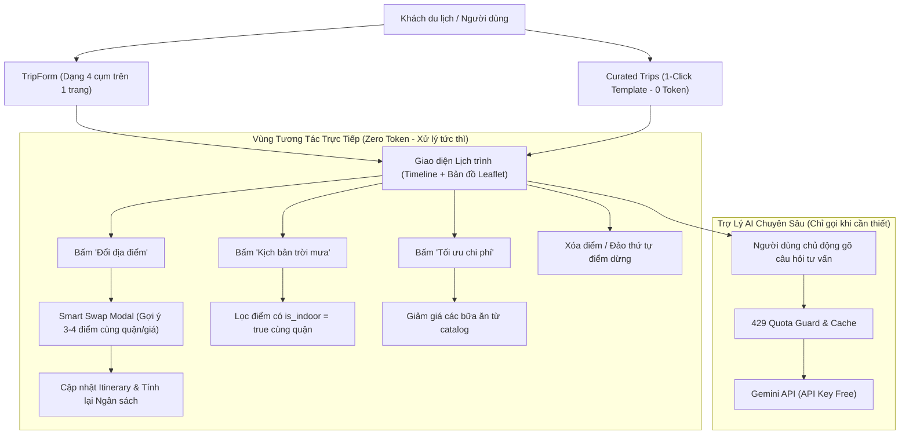

# 🗺️ KẾ HOẠCH NÂNG CẤP HỆ THỐNG TRAVEL AI TP.HCM
## Tối ưu Hạn ngạch API Key, Giảm Phụ thuộc Chatbot, Form Du lịch Thực tế (Dạng Từng Cụm) & Đặc tả Dữ liệu Database

> 📌 **Tài liệu bàn giao cho nhóm phát triển (Development Team Handover)**  
> **Mục tiêu chính**: Khắc phục triệt để tình trạng nghẽn/hết quota Gemini API Key miễn phí bằng cách chuyển dịch các luồng nghiệp vụ lặp lại (đổi địa điểm, tối ưu ngân sách, thời tiết mưa) sang **Direct UI Action + Heuristic Local Engine** (0 token); nâng cấp **Form lập lịch trình thực tế dạng từng cụm (Grouped Sections)** cho người dùng thật tại TP.HCM; và cung cấp **Đặc tả chuẩn cấu trúc Database** để chuẩn bị dữ liệu đầu vào.

---

## 🎯 BỐI CẢNH & QUYẾT ĐỊNH THIẾT KẾ ĐÃ CHỐT

1. **Về luồng tương tác (UI Action vs Chatbot)**:
   - **Thực trạng**: Hiện tại khi bấm đổi điểm hay tối ưu lịch trình, hệ thống tự động sinh tin nhắn chat văn bản gửi vào Gemini AI. Điều này gây tốn token, tốc độ phản hồi chậm (vài giây), dễ bị lỗi `429 Quota Exceeded`, và người dùng không được trực tiếp CHỌN điểm mình thích.
   - **Giải pháp**: Xây dựng **Smart Swap Modal** hiển thị ngay 3-4 địa điểm tương đồng (cùng quận, cùng loại hình, tầm giá tương đương) từ catalog local để người dùng click chọn trực tiếp trong **0.1s và tốn 0 token AI**.
   - **Chatbot**: Giữ vai trò là trợ lý tư vấn chuyên sâu theo yêu cầu (On-Demand Local Guide), KHÔNG tự động gọi khi mở trang, chỉ chạy khi người dùng chủ động đặt câu hỏi tự do.

2. **Về thiết kế Form (Đã chọn: Dạng từng cụm - Grouped Sections)**:
   - Toàn bộ form nằm trên 1 trang trực quan, không chia thành nhiều bước (no multi-step wizard) để người dùng có cái nhìn tổng quan toàn bộ chuyến đi.
   - Phân chia thành **4 cụm module rõ ràng** (Cụm Cơ bản ➔ Cụm Đoàn & Di chuyển ➔ Cụm Phong cách & Nhịp độ ➔ Cụm Sở thích & Lưu ý sức khỏe/thời tiết).

3. **Phân chia công việc cho các thành viên trong nhóm**:
   - **Thành viên A (Logic & Data Core)**: Phụ trách `catalogService.js`, thuật toán gợi ý điểm tương đồng, bộ lọc kịch bản mưa, tính toán ngân sách và script nạp Database.
   - **Thành viên B (UI/UX Itinerary & Interactivity)**: Phụ trách `SwapPlaceModal.jsx`, `ItineraryToolbar.jsx`, các nút xóa/đảo thứ tự điểm trên `TimelineItem.jsx`.
   - **Thành viên C (Form & Landing Page)**: Phụ trách nâng cấp `TripForm.jsx` (dạng từng cụm), bộ lịch trình mẫu `curatedTrips.js` và `CuratedTripCard.jsx`.
   - **Thành viên D (AI Guard & Review)**: Phụ trách tối ưu `api.js`, xử lý lỗi 429 Quota Guard, gỡ bỏ trigger chat tự động và hoàn thiện hệ thống test.

---

## 🏗️ KIẾN TRÚC TỔNG THỂ (SYSTEM ARCHITECTURE)



---

## 📋 CHI TIẾT 6 MODULE CÔNG VIỆC (TASK ASSIGNMENT)

---

### MODULE 1: Bộ máy Heuristic & Catalog Cục bộ (Zero-Token Core)
> **Người thực hiện:** Thành viên phụ trách Logic & Data  
> **Mục tiêu:** Cung cấp toàn bộ hàm lọc, gợi ý điểm thay thế, tối ưu ngân sách mà không cần gọi API ngoài.

#### Tệp tin:
- Tạo mới: `FE/FE/src/lib/catalogService.js`
- Test: `FE/FE/test/catalogService.test.js`

#### Các hàm bắt buộc triển khai:
1. `getSwapAlternatives(currentItem, currentItinerary, maxResults = 3)`:
   - **Đầu vào**: Điểm muốn đổi `currentItem`, danh sách toàn bộ điểm đang có `currentItinerary`.
   - **Thuật toán chấm điểm (Scoring Heuristic)**:
     - Điểm cùng `category`: +10 điểm.
     - Điểm cùng `district` (hoặc quận lân cận, VD: Q1 gần Q3, Q4; Q5 gần Q10, Q6): +15 điểm.
     - Cùng tính chất `is_indoor` (nếu đang ở kịch bản tránh mưa): +8 điểm.
     - Độ chênh lệch chi phí (`Math.abs(cost - currentCost) <= 30000`): +5 điểm.
     - **Điều kiện loại trừ**: KHÔNG được trùng với bất kỳ `place_id` nào đã xuất hiện trong `currentItinerary`.
   - **Đầu ra**: Mảng 3 địa điểm có điểm số cao nhất kèm trường `swap_reason` (VD: "Cùng Quận 1 · Tương đồng mức giá").

2. `applyRainyPlan(items)`:
   - Quét qua toàn bộ điểm dừng. Nếu điểm có `is_indoor === false` (ngoài trời như Phố đi bộ Nguyễn Huệ, Bến Bạch Đằng, Landmark 81 Park):
   - Tự động thay thế bằng một địa điểm `is_indoor === true` (Bảo tàng, Cà phê chung cư, Triển lãm nghệ thuật) trong cùng quận.

3. `optimizeBudget(items, targetBudget)`:
   - Nếu tổng chi phí > `targetBudget`:
   - Tìm các mục thuộc nhóm `food` và `cafe` có chi phí cao, thay thế bằng các quán ăn đường phố / quán cafe bình dân nổi tiếng cùng quận trong catalog.

#### Kiểm thử & Nghiệm thu:
Chạy lệnh: `node --test FE/FE/test/catalogService.test.js` ➔ Phải xanh 100%.

---

### MODULE 2: Giao diện Tương tác Trực tiếp Lịch trình (Smart Swap & Quick Actions)
> **Người thực hiện:** Thành viên phụ trách UI/UX Itinerary  
> **Mục tiêu:** Xóa bỏ hoàn toàn việc chat bằng chữ khi muốn đổi điểm hoặc điều chỉnh lịch trình.

#### Tệp tin:
- Tạo mới: `FE/FE/src/components/itinerary/SwapPlaceModal.jsx`
- Tạo mới: `FE/FE/src/components/itinerary/ItineraryToolbar.jsx`
- Chỉnh sửa: `FE/FE/src/components/itinerary/TimelineItem.jsx`
- Chỉnh sửa: `FE/FE/src/components/itinerary/ItineraryPanel.jsx`

#### Chi tiết thành phần:

1. **`SwapPlaceModal.jsx` (Modal Gợi ý Đổi điểm 1-Click)**:
   - Kích hoạt khi bấm nút `[🔄 Đổi địa điểm]` trên bất kỳ thẻ nào.
   - **Giao diện Modal**:
     - Tiêu đề: *"Đổi địa điểm: [Tên địa điểm hiện tại]"*
     - Danh sách 3 Card gợi ý lấy từ `getSwapAlternatives()`:
       - Hình ảnh thu nhỏ, tên địa điểm, danh mục (badge màu), địa chỉ/quận, giá tiền, rating sao.
       - Dòng lý do: *"Gợi ý vì: Cùng Quận 1 · Cách điểm kế tiếp 1.2km"*.
       - Nút hành động: `[Chọn địa điểm này]` ➔ Click vào là đổi ngay lập tức trên timeline, tự đóng modal, hiển thị Toast thông báo thành công.
     - Tab mở rộng (phía dưới): *"Bạn muốn tìm điểm đặc biệt hơn? Nhờ AI gợi ý riêng"* (chỉ khi click tab này mới hiển thị ô nhập prompt để gọi Gemini).

2. **`ItineraryToolbar.jsx` (Thanh công cụ thao tác nhanh)**:
   - Đặt trên đầu danh sách lịch trình (dưới phần bản đồ).
   - Gồm các nút bấm trực tiếp:
     - `[🌧️ Kịch bản trời mưa]`: Bật toggle chuyển các điểm ngoài trời thành điểm trong nhà máy lạnh.
     - `[⚡ Tối ưu ngân sách]`: Giảm chi phí ăn uống/tham quan về mức tiết kiệm.
     - `[☕ Thêm trạm cà phê]`: Thêm 1 điểm cafe gần nhất vào khung giờ 14:00 - 15:30.

3. **Cải tiến `TimelineItem.jsx`**:
   - Thêm nút xóa `[🗑️]` (kèm xác nhận nhẹ).
   - Thêm 2 nút `[▲]` và `[▼]` để di chuyển thứ tự điểm dừng trong cùng 1 ngày mà không cần chat với AI.

---

### MODULE 3: Form Lập Lịch Trình Chuyên Sâu (Thiết kế Dạng Từng Cụm)
> **Người thực hiện:** Thành viên phụ trách Form & Đầu vào  
> **Mục tiêu:** Thu thập đầy đủ 8+ tiêu chí thực tế của người dùng thật du lịch TP.HCM trên 1 giao diện trực quan, không chia wizard nhiều trang.

#### Tệp tin:
- Chỉnh sửa: `FE/FE/src/components/TripForm.jsx`
- Chỉnh sửa: `FE/FE/src/i18n/translations.js`

#### Bố cục 4 Cụm Module trên Form (Grouped Sections Layout):

```
┌────────────────────────────────────────────────────────────────────────┐
│ 📍 CỤM 1: THÔNG TIN CƠ BẢN (TRỌNG TÂM CHUYẾN ĐI)                       │
│  - Nơi lưu trú / Điểm xuất phát: [Dropdown chọn Quận / Nhập địa chỉ]   │
│  - Số ngày du lịch: [-] [ 3 ngày ] [+] (1 - 14 ngày)                   │
│  - Tổng ngân sách dự kiến: [ 3,000,000 VND ]                           │
│    Các mốc nhanh: [1.5Tr] [3Tr] [5Tr] [10Tr]                           │
├────────────────────────────────────────────────────────────────────────┤
│ 👥 CỤM 2: THÀNH PHẦN ĐOÀN & PHƯƠNG TIỆN DI CHUYỂN                      │
│  - Đối tượng đi cùng (Single-choice chips):                            │
│    [👤 Đi 1 mình] [❤️ Cặp đôi] [👥 Nhóm bạn] [👨‍👩‍👧 Gia đình có trẻ/người lớn]│
│  - Phương tiện di chuyển chính (Single-choice chips):                  │
│    [🛵 Xe máy / GrabBike] [🚗 Ô tô / GrabCar] [🚇 Metro & Đi bộ]        │
├────────────────────────────────────────────────────────────────────────┤
│ ⚡ CỤM 3: NHỊP ĐỘ CHUYẾN ĐI & KHUNG GIỜ SINH HOẠT                      │
│  - Nhịp độ (Pace):                                                     │
│    [🍃 Thong thả (2-3 điểm/ngày)] [⚖️ Cân bằng (3-4 điểm)] [🔥 Khám phá tối đa (5-6 điểm)] │
│  - Thói quen sinh hoạt:                                                │
│    [🌅 Dậy sớm ngắm phố (từ 6h30)] [🌙 Cú đêm / Thích nightlife (đến 24h)] │
├────────────────────────────────────────────────────────────────────────┤
│ 🍜 CỤM 4: SỞ THÍCH TRẢI NGHIỆM & LƯU Ý ĐẶC BIỆT                       │
│  - Sở thích (Chọn tối đa 4):                                           │
│    [🍜 Ẩm thực] [🏛️ Di tích] [☕ Cà phê] [🛍️ Mua sắm] [🌳 Thiên nhiên] [🍸 Nightlife] │
│  - Lưu ý sức khỏe / Thời tiết (Multi-select tags):                    │
│    [🥗 Ăn chay] [🌶️ Không ăn cay] [❄️ Ưu tiên máy lạnh/trong nhà] [🚶 Hạn chế đi bộ xa] │
└────────────────────────────────────────────────────────────────────────┘
          [ 🚀 BẮT ĐẦU TẠO LỊCH TRÌNH THÔNG MINH TP.HCM ]
```

#### Dữ liệu đầu ra của Form (`TripPayload`):
```json
{
  "start_location": "Quận 1, TP. Hồ Chí Minh",
  "district_focus": ["Quận 1", "Quận 3"],
  "days": 3,
  "budget": 3000000,
  "group_type": "couple",
  "transport_mode": "motorbike",
  "pace": "moderate",
  "schedule_profile": "night_owl",
  "preferences": ["food", "cafe", "culture"],
  "special_notes": ["ac_preferred", "no_spicy"]
}
```

---

### MODULE 4: Lịch Trình Mẫu Sài Gòn 1-Click (Curated Starter Trips)
> **Người thực hiện:** Thành viên phụ trách Giao diện Landing Page  
> **Mục tiêu:** Giúp người dùng mới không cần nhập form cũng có thể trải nghiệm ngay lịch trình chất lượng cao (0 token AI).

#### Tệp tin:
- Tạo mới: `FE/FE/src/lib/curatedTrips.js`
- Tạo mới: `FE/FE/src/components/CuratedTripCard.jsx`
- Chỉnh sửa: `FE/FE/src/pages/LandingPage.jsx`

#### 4 Gói Lịch Trình Chuẩn TP.HCM được đóng gói sẵn:
1. **"24h Oanh Tạc Ẩm Thực Đường Phố Sài Gòn"** (1 ngày, Ngân sách: ~500k):
   - Sáng: Bánh mì Huỳnh Hoa / Phở Pasteur ➔ Cafe Vợt Phan Đình Phùng.
   - Trưa: Cơm tấm Ba Ghiền Phú Nhuận.
   - Chiều: Chợ Bến Thành & Trà sữa Hồ Con Rùa.
   - Tối: Phố ẩm thực Ốc Vĩnh Khánh (Quận 4) ➔ Bia tươi Phố Bùi Viện.
2. **"Dấu Ấn Di Sản & Văn Hóa Chợ Lớn (Quận 5)"** (1 ngày, Ngân sách: ~700k):
   - Chùa Bà Thiên Hậu ➔ Phố Đông y Hải Thượng Lãn Ông ➔ Dimsum Tiến Phát ➔ Chợ Bình Tây ➔ Hào Sĩ Phường.
3. **"Cuối Tuần Lãng Mạn Cho Cặp Đôi (Quận 1 & TP. Thủ Đức)"** (2 ngày, Ngân sách: ~2.5Tr):
   - Saigon Waterbus Bạch Đằng ➔ Bảo tàng Mỹ thuật TP.HCM ➔ Cafe Workshop Đồng Khởi ➔ Du thuyền Saigon Princess ăn tối trên sông.
4. **"Khám Phá Sài Gòn Cùng Gia Đình Có Bé Nhỏ"** (3 ngày, Ngân sách: ~4Tr):
   - Thảo Cầm Viên Sài Gòn (mát mẻ, nhiều cây xanh) ➔ Dinh Độc Lập ➔ Bảo tàng Áo Dài ➔ Trung tâm thương mại Takashimaya có khu vui chơi trong nhà.

Khi click nút `[Sử dụng lịch trình này]`, hệ thống tự động copy vào danh sách `My Trips` và mở thẳng trang xem chi tiết mà không cần gọi API.

---

### MODULE 5: Kiểm Soát Hạn Ngạch AI & Chat Chống Nghẽn (On-Demand AI & 429 Guard)
> **Người thực hiện:** Thành viên phụ trách API & Tích hợp  
> **Mục tiêu:** Bảo vệ API Key miễn phí, chống crash khi quá giới hạn request/phút.

#### Tệp tin:
- Chỉnh sửa: `FE/FE/src/pages/TripPage.jsx`
- Chỉnh sửa: `FE/FE/src/components/chat/ChatPanel.jsx`
- Chỉnh sửa: `FE/FE/src/lib/api.js`

#### Nhiệm vụ:
1. **Gỡ bỏ useEffect khởi động chat tự động**: Trong `TripPage.jsx` (dòng 205–228), xóa bỏ đoạn code tự động bắn câu chào AI mỗi khi tải chuyến đi mới. Thay vào đó, hiển thị ngay bảng tổng quan hành trình.
2. **Cơ chế 429 Fallback Guard trong `api.js`**:
   - Bắt mã lỗi `429` (hoặc chuỗi `RESOURCE_EXHAUSTED` từ Gemini).
   - Thay vì báo lỗi đỏ lên màn hình, tự động trả về phản hồi lịch thiệp:
     > *"Trợ lý bản địa: Hiện lượng truy cập đến máy chủ AI đang cao. Mình đã dùng cẩm nang du lịch local để điều chỉnh lịch trình tối ưu nhất cho bạn rồi nhé!"*
3. **Smart Prompt Chips**: Thay vì các chip lệnh điều khiển UI (như "Làm rẻ hơn", "Thêm cafe"), chuyển thành các câu hỏi mang tính cẩm nang:
   - *"Gợi ý quán ốc ngon mở sau 22h gần đây"*
   - *"Lưu ý an toàn khi đi xe máy ban đêm tại TP.HCM"*
   - *"Cách mua vé tàu Waterbus Bến Bạch Đằng"*

---

### MODULE 6: Đặc Tả Dữ Liệu Database & Hướng Dẫn Thu Thập (Data Specification)
> **Người thực hiện:** Thành viên phụ trách Database & Người đi thu thập dữ liệu  
> **Mục tiêu:** Chuẩn hóa toàn bộ trường thông tin để thành viên đi thu thập dữ liệu vào 1 folder, sau đó chạy script import tự động.

#### Quy chuẩn cấu trúc Folder dữ liệu cần thu thập:
Thành viên thu thập dữ liệu sẽ tạo thư mục tên `data-catalog/` ở thư mục gốc của project với cấu trúc:
```text
website-ai-travel/
├── data-catalog/
│   ├── places.csv  (hoặc places.json)      <-- Chứa danh sách ~30-50 địa điểm TP.HCM
│   ├── curated_trips.json                   <-- Chứa danh sách các tour mẫu
│   └── images/                              <-- Chứa ảnh tương ứng (jpg, png, webp)
│       ├── dinh-doc-lap.jpg
│       ├── pho-pasteur.jpg
│       └── ben-thanh.jpg
```

#### Bảng thông tin chi tiết các trường của file `places.csv` (hoặc `places.json`):

| Tên trường (Cột) | Kiểu dữ liệu | Bắt buộc | Mô tả & Hướng dẫn nhập liệu tại TP.HCM | Ví dụ mẫu |
|---|---|---|---|---|
| `place_id` | String | Có | Khóa định danh không dấu, nối bằng gạch ngang | `dinh-doc-lap`, `pho-hoa-pasteur` |
| `name` | String | Có | Tên địa điểm tiếng Việt đầy đủ | Dinh Độc Lập, Phở Hòa Pasteur |
| `name_en` | String | Không | Tên tiếng Anh (dành cho khách nước ngoài) | Independence Palace |
| `category` | String | Có | 1 trong 6 loại: `food`, `cafe`, `sightseeing`, `shopping`, `nature`, `entertainment` | `sightseeing` |
| `sub_category` | String | Không | Thể loại chi tiết | `museum`, `street_food`, `rooftop` |
| `district` | String | Có | Tên Quận/Huyện chính xác | `Quận 1`, `Quận 3`, `Quận 5`, `TP. Thủ Đức` |
| `address` | String | Có | Số nhà, tên đường, phường, quận | 135 Nam Kỳ Khởi Nghĩa, Bến Thành, Quận 1 |
| `latitude` | Float | Có | Tọa độ vĩ độ (lấy trên Google Maps hoặc OpenStreetMap) | `10.7770` |
| `longitude` | Float | Có | Tọa độ kinh độ | `106.6953` |
| `price_min` | Integer | Có | Chi phí tối thiểu mỗi người (VND) | `65000` |
| `price_max` | Integer | Có | Chi phí tối đa mỗi người (VND) | `65000` |
| `recommended_duration` | Integer | Có | Thời gian trải nghiệm ước tính tính bằng **phút** | `90` (cho bảo tàng), `45` (cho ăn phở) |
| `opening_hours` | String | Có | Khung giờ hoạt động trong ngày | `07:30 - 17:00` |
| `best_time` | String | Không | Buổi lý tưởng nhất: `morning`, `noon`, `afternoon`, `evening`, `night` | `morning` |
| `is_indoor` | Boolean | Có | `true`: Trong nhà / có máy lạnh (dành cho kịch bản mưa nắng) | `true` |
| `suitable_for` | String / Array | Có | Đối tượng thích hợp: `solo`, `couple`, `friends`, `family`, `elderly` | `solo,friends,family` |
| `rating` | Float | Có | Điểm đánh giá (1.0 đến 5.0) | `4.8` |
| `editorial_summary` | String | Có | 1-2 câu giới thiệu đặc sắc về nét đẹp Sài Gòn của điểm này | Di tích lịch sử biểu tượng giữa trung tâm thành phố. |
| `local_tips` | String | Không | Mẹo riêng của người Sài Gòn (gửi xe, giờ vắng, món nên gọi) | Nên gửi xe ở cổng đường Huyền Trân Công Chúa. |
| `photo_file` | String | Có | Tên file ảnh đặt trong thư mục `images/` | `dinh-doc-lap.jpg` |
| `tags` | String / Array | Không | Nhãn tìm kiếm mở rộng | `di_tich,song_ao,trung_tam` |

---

## 🛠️ HƯỚNG DẪN CÁC LỆNH CHẠY & KIỂM THỬ DÀNH CHO NHÓM

Khi các thành viên trong nhóm nhận task và thực hiện, hãy sử dụng các lệnh chuẩn sau từ thư mục gốc dự án:

```bash
# 1. Chạy môi trường Frontend đang phát triển (port 5173)
cd FE/FE && npm run dev

# 2. Kiểm tra tính toàn vẹn của mã nguồn (Build & Lint)
npm run build

# 3. Chạy toàn bộ các bài kiểm thử tự động
node --test FE/FE/test/*.test.js

# 4. Kiểm tra cổng mạng nếu bị kẹt
lsof -nP -iTCP:5173 -sTCP:LISTEN
```

---

## ✅ KẾT LUẬN & TRÌNH TỰ BÀN GIAO CHO NHÓM

Để nhóm triển khai mượt mà nhất, khuyến nghị phân bổ công việc theo trình tự:
1. **Tuần 1**: 
   - Thành viên thu thập dữ liệu bắt đầu lập bảng `data-catalog/places.csv` và tải ảnh vào `images/`.
   - Thành viên A viết `catalogService.js` và test logic gợi ý (Module 1).
   - Thành viên C dựng giao diện `TripForm.jsx` dạng 4 cụm trên FE (Module 3).
2. **Tuần 2**:
   - Thành viên B tích hợp `SwapPlaceModal.jsx` và thanh công cụ `ItineraryToolbar.jsx` (Module 2).
   - Thành viên C hoàn thiện `CuratedTripCard.jsx` đưa lên Landing Page (Module 4).
   - Thành viên D gắn `429 Quota Guard`, dọn dẹp các lệnh gọi chat tự động trong `TripPage.jsx` và chạy kiểm thử toàn diện (Module 5).
