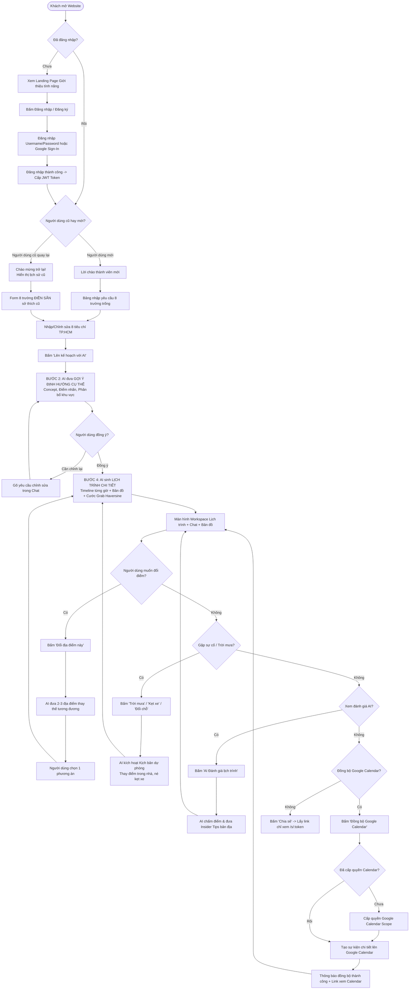

# 🗺️ USER FLOW: HCMC AI TRAVEL PLANNER (7 YÊU CẦU MỚI)

---

## 1. SƠ ĐỒ LUỒNG TỔNG THỂ (MERMAID USER FLOW)

---

## 2. MÔ TẢ CHI TIẾT TỪNG GIAI ĐOẠN

### Giai đoạn 1: Tiếp cận & Xác thực (Authentication Gate)
- **Khách truy cập:** Chỉ thấy giao diện giới thiệu (Hero banner, tính năng nổi bật, phản hồi mẫu). Mọi thao tác tạo lịch trình đều kích hoạt modal yêu cầu đăng nhập.
- **Xác thực:** Người dùng chọn đăng nhập bằng tài khoản hoặc Google. Sau khi có JWT, ứng dụng tự động kiểm tra số lượng chuyến đi cũ.

### Giai đoạn 2: Tiếp nhận yêu cầu (8 tiêu chí TP.HCM)
- **Người dùng mới:** Tiếp nhận form trống, có placeholder hướng dẫn rõ ràng.
- **Người dùng cũ:** Hệ thống tự động nạp từ CSDL các thông tin quen thuộc (Quận yêu thích, phương tiện hay đi, nhịp độ chuyến đi, số người) vào form. Người dùng chỉ cần duyệt nhanh.

### Giai đoạn 3: Luồng tương tác AI 4 bước
- Thay vì sinh ngay lịch trình 100% chi tiết dễ gây sai lệch ý muốn, AI trước tiên đưa ra **bản tóm tắt định hướng (Trip Concept)** để người dùng xác nhận.
- Khi người dùng đồng ý, AI mới tiến hành truy vấn Google Places và ghép nối lộ trình chi tiết.

### Giai đoạn 4: Vận hành & Dự phòng thông minh
- Khung nhìn chia đôi (Split-View): Bên trái là đàm thoại AI có nhúng bản đồ nhỏ; bên phải là Timeline dọc và Google Maps toàn cảnh.
- Xử lý đổi địa điểm mượt mà với 2-3 gợi ý cụ thể.
- Kịch bản thời tiết (mưa/kẹt xe) giúp thay đổi lộ trình tức thì chỉ bằng một thao tác chạm.

### Giai đoạn 5: Đóng gói & Lan tỏa giá trị (Calendar & Share)
- Đưa toàn bộ các chặng đi vào Google Calendar để nhận thông báo nhắc nhở tự động trên điện thoại.
- Yêu cầu AI chấm điểm chuyên gia và xuất link chia sẻ cho bạn bè cùng xem.
