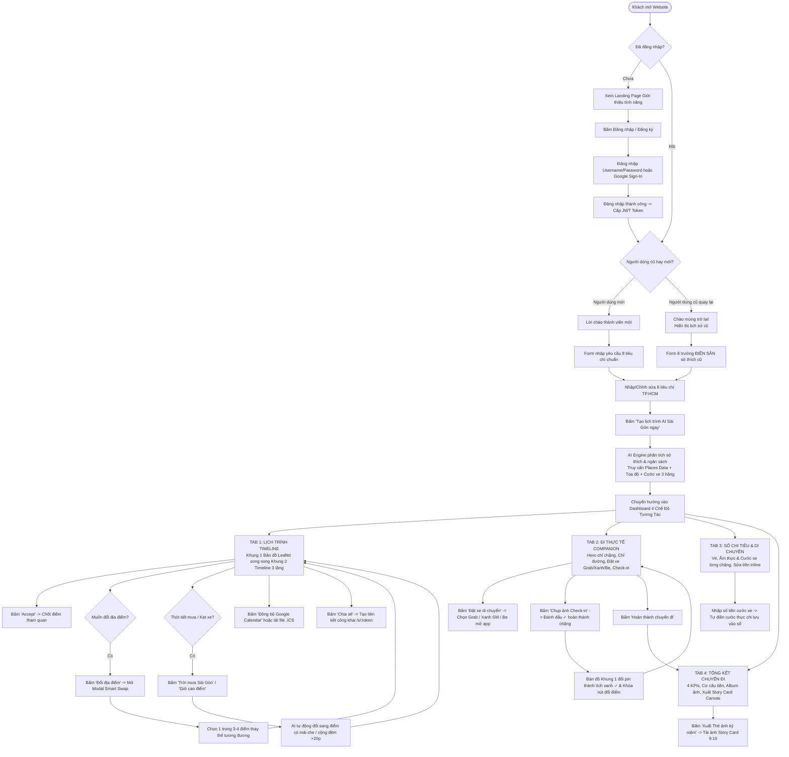

# 🗺️ USER FLOW: HCMC AI TRAVEL PLANNER (SÀI GÒN GUIDE)
## QUY TRÌNH TRẢI NGHIỆM NGƯỜI DÙNG KHÉP KÍN 6 GIAI ĐOẠN

---

## 1. SƠ ĐỒ LUỒNG TỔNG THỂ (MERMAID USER FLOW)

---

## 2. MÔ TẢ CHI TIẾT TỪNG GIAI ĐOẠN TRẢI NGHIỆM

### Giai đoạn 1: Tiếp cận & Xác thực Danh tính (Authentication Gate)
- **Khách truy cập:** Xem giao diện giới thiệu Landing Page (Hero 3D, danh mục điểm đến, review). Khách đăng nhập qua tài khoản hoặc Google OAuth 2.0.
- **Xác thực an toàn:** Hệ thống cấp phát JWT Token và nạp thông tin người dùng.

### Giai đoạn 2: Khảo sát Nhu cầu Du lịch (8 Tiêu chí Đặc thù TP.HCM)
- Người dùng tương tác trực tiếp với **Form khảo sát thông minh**:
  1. Số ngày (1 - 14 ngày)
  2. Khu vực / Quận ưu tiên tại TP.HCM
  3. Ngân sách dự trù (VND)
  4. Sở thích cốt lõi (ẩm thực đường phố, di tích lịch sử, cafe specialty, mua sắm...)
  5. Đối tượng đi cùng (Solo, Cặp đôi, Nhóm bạn, Gia đình)
  6. Phương tiện di chuyển ưu tiên
  7. Nhịp độ chuyến đi (Thong thả, Cân bằng, Năng động)
  8. Ghi chú cá nhân đặc biệt.
- **Người dùng cũ:** Hệ thống tự động điền sẵn (pre-fill) các sở thích quen thuộc từ chuyến trước.

### Giai đoạn 3: AI Engine Tối ưu hóa & Đưa vào Dashboard
- Người dùng bấm *"Tạo lịch trình AI Sài Gòn ngay"*, AI Engine (Google Gemini 2.5 Flash) kết hợp thuật toán Haversine và cơ sở dữ liệu địa điểm để tính toán lộ trình tối ưu nhất.
- Hệ thống điều hướng tức thì vào **Màn hình Chuyến đi (`/trip/:id`)** với **4 Chế độ Trải nghiệm** trực quan mà không cần đàm thoại qua khung lịch trình gõ chữ.

### Giai đoạn 4: Tinh chỉnh Lịch trình Trực quan (Tab 1: Lịch trình Timeline)
- **Bố cục 2 Khung hình Song song:**
  - *Khung 1 (Bản đồ tương tác):* Bản đồ Leaflet vẽ lộ trình các chặng [1, 2, 3, 4] trong ngày.
  - *Khung 2 (Lịch trình 3 tầng):* Hiển thị thời gian biểu, tên địa điểm không bao giờ bị đè chữ, nút *Accept* chốt điểm, và nút *Đổi địa điểm (AI Smart Swap)* mở Modal chọn 3-4 điểm thay thế.
- **Kịch bản thích ứng:** Bấm nút *[Trời mưa Sài Gòn]* hoặc *[Giờ cao điểm]* để AI tự động chuyển các điểm ngoài trời sang điểm trong nhà có mái che hoặc cộng thời gian đệm kẹt xe.

### Giai đoạn 5: Đồng hành Thực địa Ngoài đường (Tab 2: Chế độ Đi thực tế Companion)
- **Thẻ Hero:** Chỉ đường đến chặng kế tiếp, khoảng cách và thời lượng.
- **Gọi xe công nghệ 3 hãng:** Bấm nút mở Modal hiển thị cước ước tính và deep-link mở thẳng ứng dụng **Grab**, **Xanh SM** (xe điện VinFast), hoặc **Be**.
- **Check-in chụp ảnh:** Du khách bấm chụp ảnh tại điểm đến -> Chặng chuyển sang trạng thái `[✓ Đã hoàn thành]`, Bản đồ Khung 1 tự động đổi pin thành dấu tích xanh `✓`, và nút đổi điểm bị khóa logic.

### Giai đoạn 6: Quản lý Chi tiêu, Đóng gói Kỷ niệm & Lan tỏa (Tab 3 & Tab 4)
- **Tab 3 (Sổ chi tiêu):** Quản lý chi phí vé, ẩm thực và **cước xe từng chặng**, cho phép khách tự do nhấp sửa cước xe thực chi trực tiếp (*inline editing*).
- **Tab 4 (Tổng kết chuyến đi):** Thống kê 4 KPI, phân bổ 3 nhóm tiền, album ảnh check-in thực tế.
- **Xuất Thẻ ảnh kỷ niệm (Story Card):** Tự động vẽ đồ họa Canvas tổng kết chuyến đi (tỷ lệ 9:16) để tải về máy chia sẻ Facebook/Instagram.
- **Đồng bộ lịch:** Tải file `.ICS` hoặc đẩy lịch lên Google Calendar.
